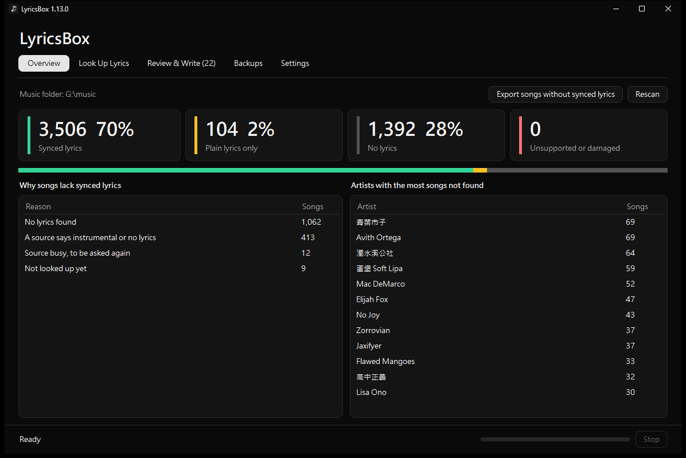
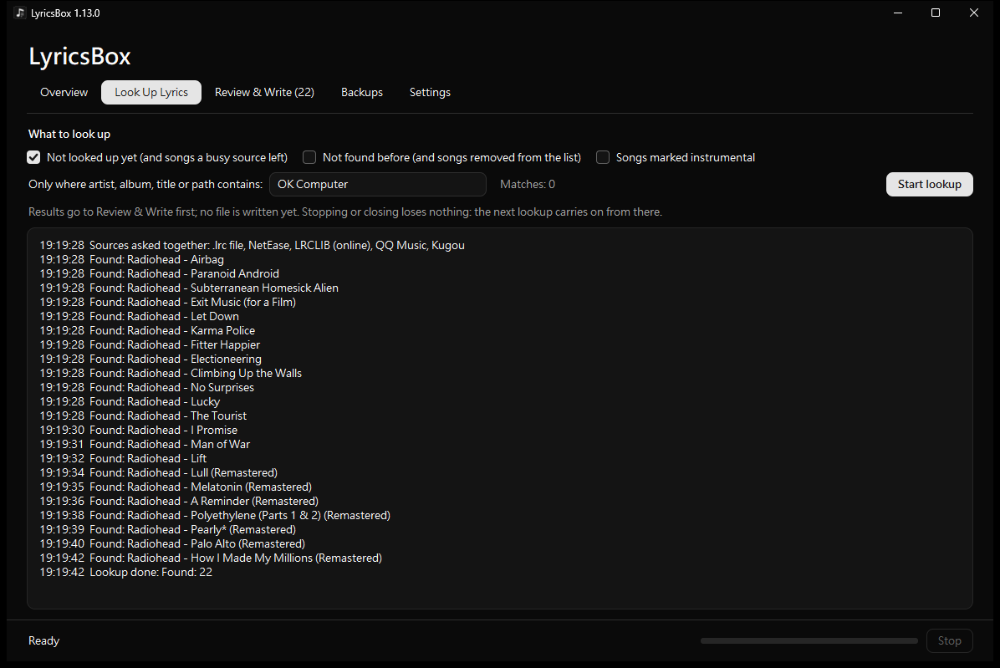
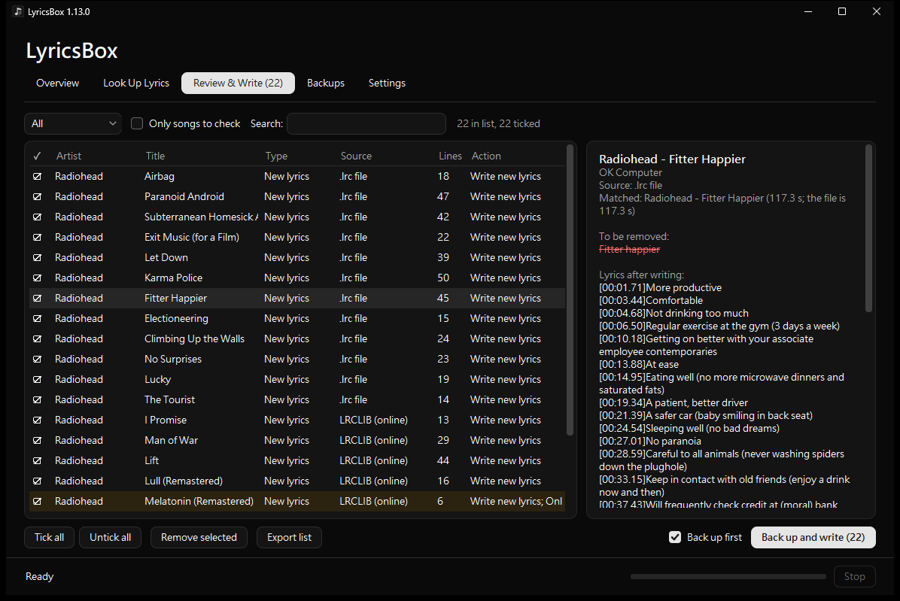
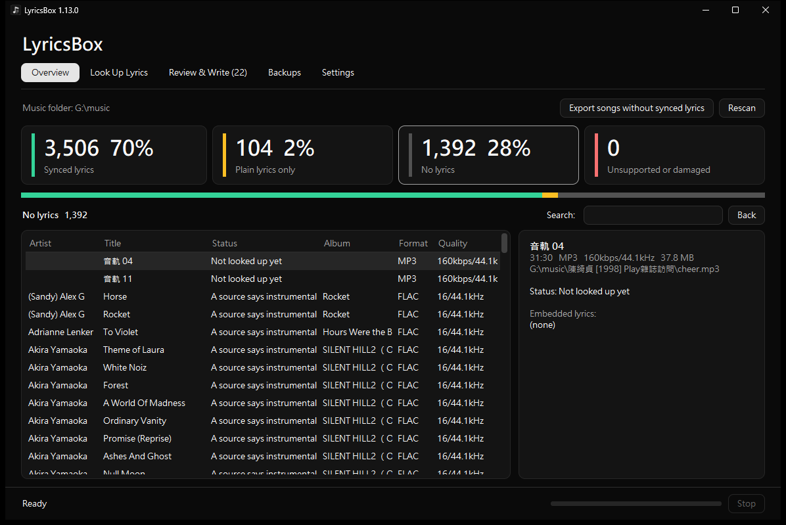
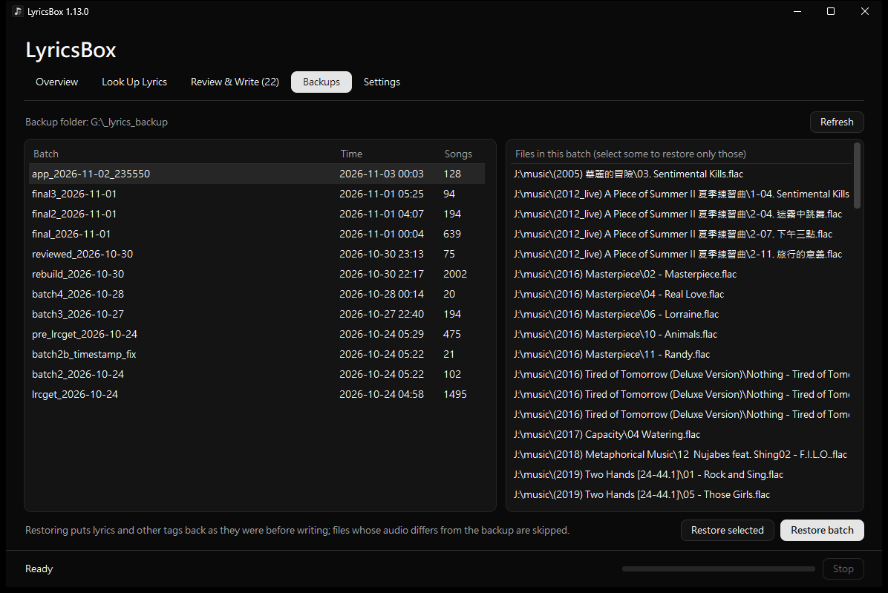
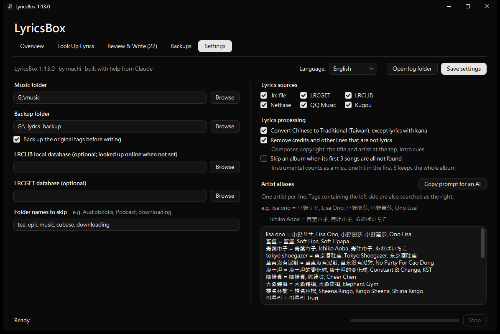
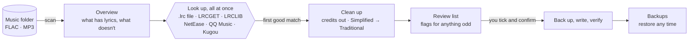
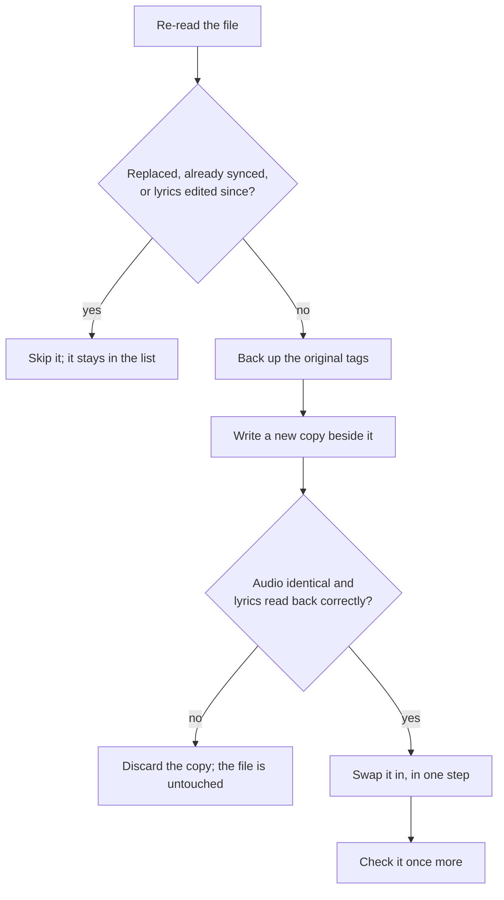

<div align="center">

# LyricsBox

**Synced lyrics for your whole music library, from 6 free sources at once.**

**English** &nbsp;·&nbsp; [繁體中文](README.zh-TW.md)


[](LICENSE)



</div>

---

Many music players only show lyrics embedded in the file. LyricsBox finds time-synced lyrics for the songs that have none, cleans them up, and writes them in after you've checked them. One `.exe`, nothing to install.

## Features

<table>
<tr>
<td width="50%" valign="top">

### 🔎 6 sources at once

The first good match wins. Busy sources are retried on their own.



</td>
<td width="50%" valign="top">

### ✅ You check before it writes

Every find waits in a list. Anything odd is flagged.



</td>
</tr>
<tr>
<td width="50%" valign="top">

### 🧹 Clean lyrics

Credits and intro cues removed. Simplified Chinese turned Traditional.



</td>
<td width="50%" valign="top">

### ♻️ Undo any time

Tags are backed up before every write.



</td>
</tr>
<tr>
<td colspan="2" valign="top">

### ⚙️ Made for big libraries

Artist aliases, folders to skip, album skipping, English or 繁體中文.



</td>
</tr>
</table>

## How it works



## Safe writing



## Getting started

1. Download `LyricsBox.exe` from [Releases](../../releases) and run it.
2. **Settings**: pick your music folder and a backup folder, then **Save settings**.
3. **Look Up Lyrics**: click **Start lookup**.
4. **Review & Write**: untick anything wrong, then **Back up and write**.

Settings and lookup history live in `%LOCALAPPDATA%\LyricsBox`.

## Development

```bat
python -m venv .venv
.venv\Scripts\pip install -r requirements.txt
build.bat
```

Tests in `tests\` never write to your library: `test_core.py` (writing and restoring on real audio), `ui_shots.py` (every flow in the real window), `exe_smoke.py` (the built exe), `source_bench.py` (each online source's hit rate).

## License

[MIT](LICENSE) · by machi, built with help from Claude
