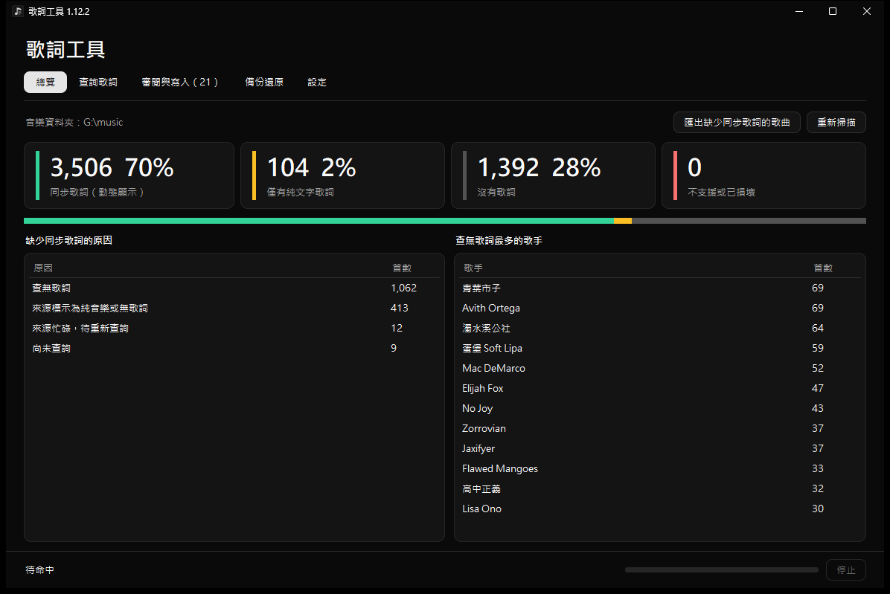
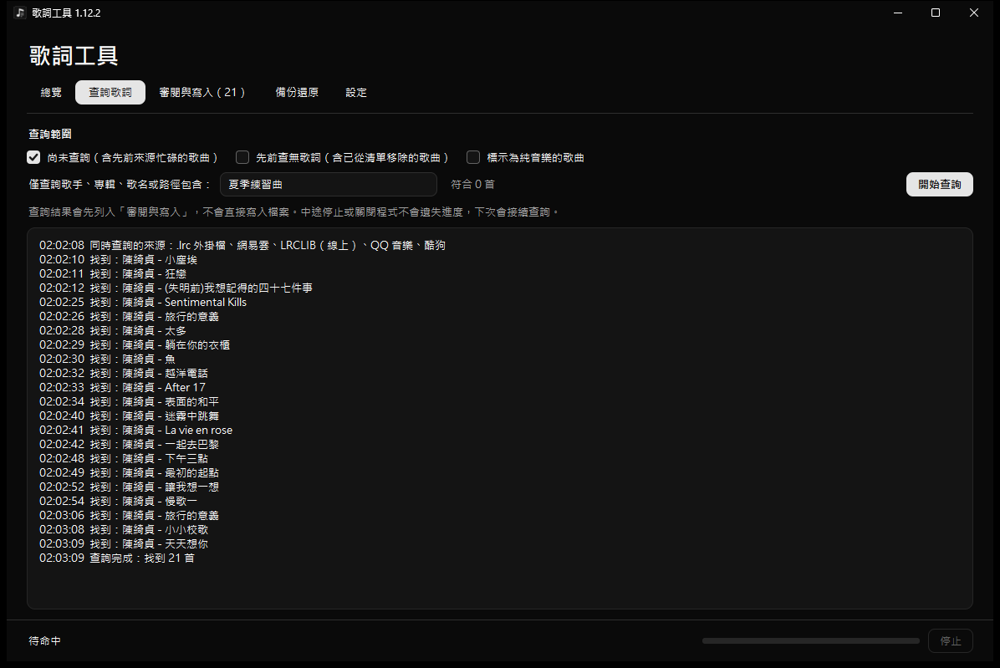
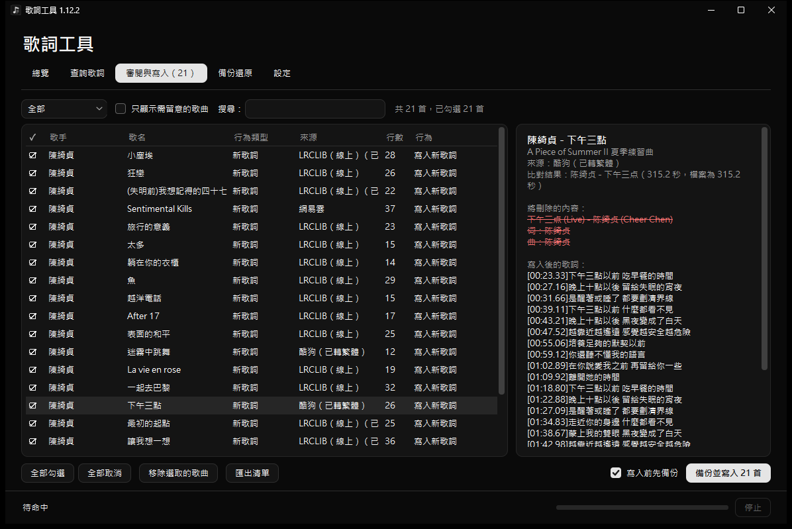
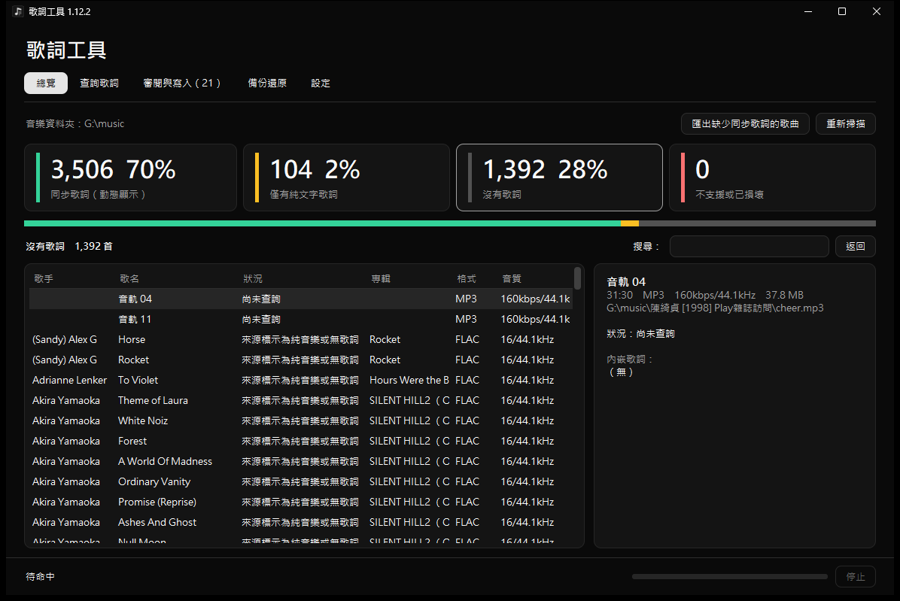
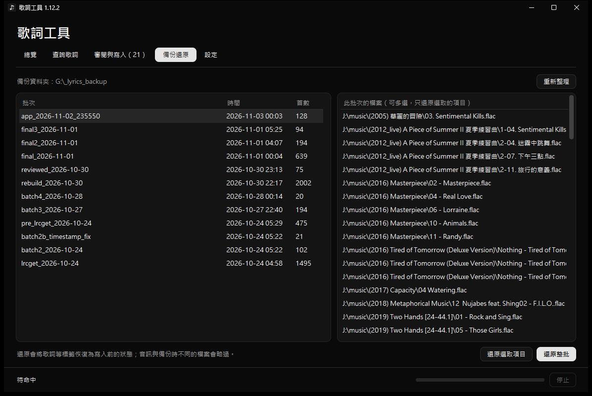
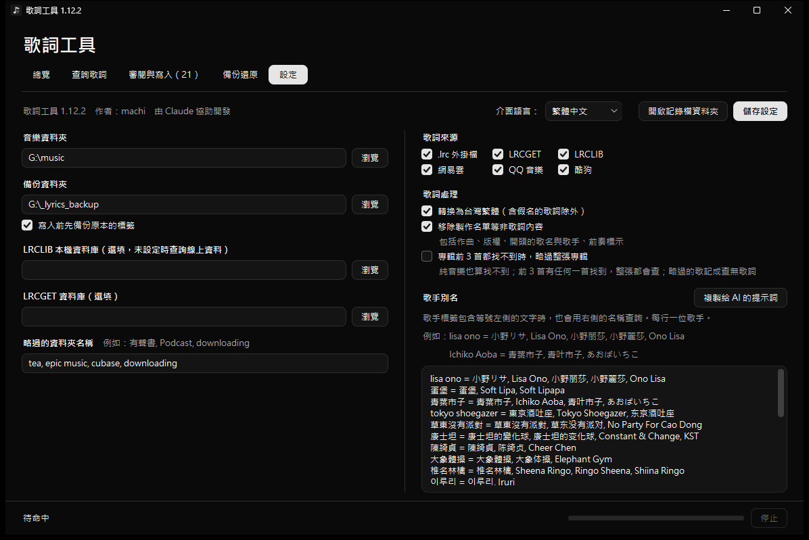
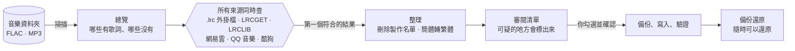
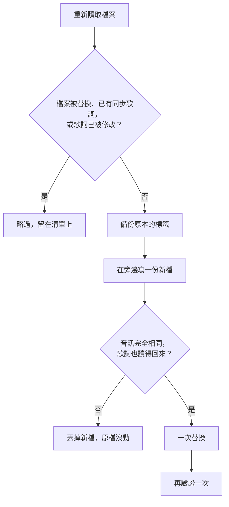

<div align="center">

# 歌詞工具 LyricsTool

**整個音樂庫的同步歌詞，6 個免費來源同時查。**

[English](README.md) &nbsp;·&nbsp; **繁體中文**


[](LICENSE)



</div>

---

很多音樂軟體只顯示內嵌在檔案裡的歌詞。歌詞工具會替沒有歌詞的歌找到同步歌詞，整理乾淨，你看過之後再寫進檔案。單一 `.exe`，不需安裝。

## 功能

<table>
<tr>
<td width="50%" valign="top">

### 🔎 6 個來源同時查

哪個先找到就用哪個，來源忙碌會自動重查。



</td>
<td width="50%" valign="top">

### ✅ 你看過才寫入

找到的歌詞先進清單，可疑的會標出來。



</td>
</tr>
<tr>
<td width="50%" valign="top">

### 🧹 乾淨的歌詞

刪掉製作名單和前奏標示，簡體轉台灣繁體。



</td>
<td width="50%" valign="top">

### ♻️ 隨時能還原

每次寫入前都會備份標籤。



</td>
</tr>
<tr>
<td colspan="2" valign="top">

### ⚙️ 為大型音樂庫設計

歌手別名、略過資料夾、略過整張專輯、繁體中文或英文介面。



</td>
</tr>
</table>

## 運作方式



## 安全的寫入



## 開始使用

1. 從 [Releases](../../releases) 下載 `LyricsTool.exe` 並執行。
2. **設定**：選擇音樂資料夾和備份資料夾，按「儲存設定」。
3. **查詢歌詞**：按「開始查詢」。
4. **審閱與寫入**：取消勾選不對的，再按「備份並寫入」。

設定和查詢紀錄存在 `%LOCALAPPDATA%\LyricsTool`。

## 開發

```bat
python -m venv .venv
.venv\Scripts\pip install -r requirements.txt
build.bat
```

`tests\` 裡的測試都不會寫入你的音樂庫：`test_core.py`（用真實音訊測寫入與還原）、`ui_shots.py`（實際操作視窗的每個流程）、`exe_smoke.py`（打包好的 exe）、`source_bench.py`（各線上來源的找到率）。

## 授權

[MIT](LICENSE) · 作者 machi，由 Claude 協助開發
